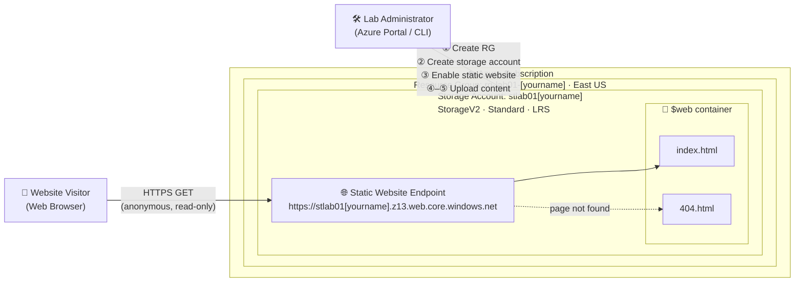
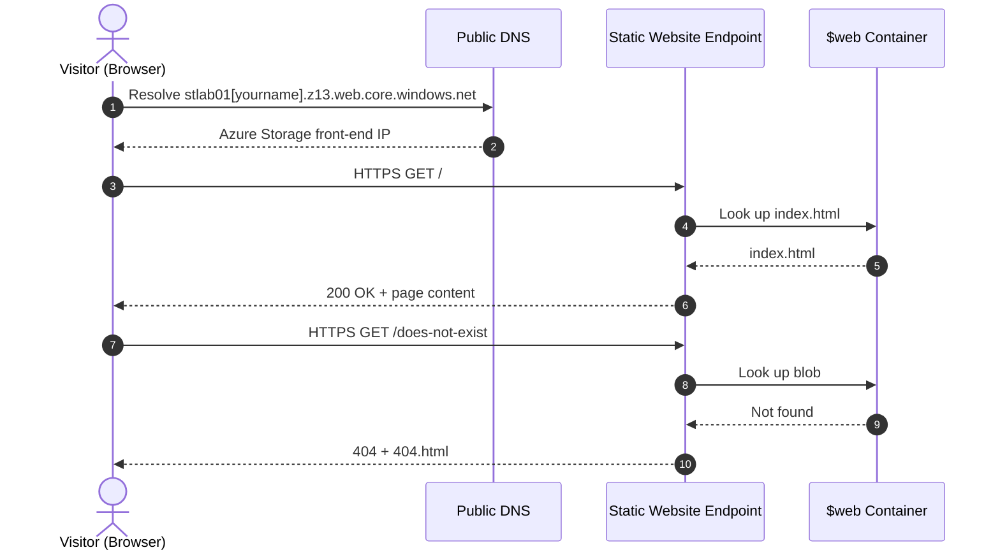
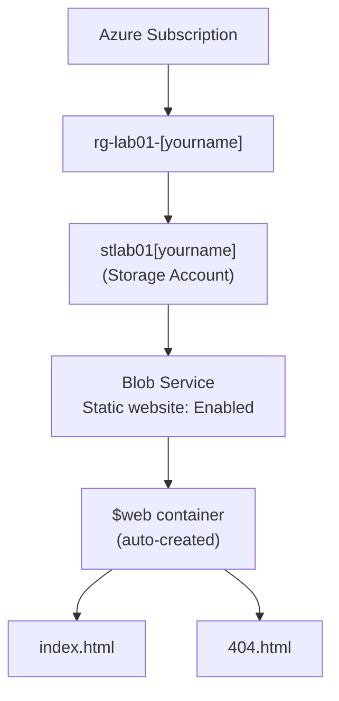

# Lab 01: Hosting a Static Website on Azure Blob Storage


> Deploy a public-facing, serverless website on Azure using Blob Storage's static website feature, with no virtual machines or web servers to manage.

**Cloud:** Microsoft Azure
**Services used:** Resource Groups, Azure Storage (StorageV2), Static Website Hosting

---

## Table of Contents

1. [Overview](#1-overview)
2. [Architecture](#2-architecture)
3. [Skills Demonstrated](#3-skills-demonstrated)
4. [Prerequisites](#4-prerequisites)
5. [Lab Variables](#5-lab-variables)
6. [Deployment: Azure Portal](#6-deployment-azure-portal)
7. [Deployment: Azure CLI (Optional)](#7-deployment-azure-cli-optional)
8. [Validation](#8-validation)
9. [Security Considerations](#9-security-considerations)
10. [Troubleshooting](#10-troubleshooting)
11. [Clean Up](#11-clean-up)
12. [Key Takeaways](#12-key-takeaways)
13. [Repository Structure](#13-repository-structure)
14. [References](#14-references)

---

## 1. Overview

This lab hosts a simple website without building a server. Instead of provisioning a VM and installing IIS or Nginx, the site is served directly from **Azure Blob Storage** using its **static website** feature.

This is an introduction to **PaaS (Platform as a Service)** and **serverless hosting**: I manage the content, and Azure manages the infrastructure, patching, scaling and availability.

**What gets built:**

- A resource group to hold all lab resources
- A StorageV2 storage account with static website hosting enabled
- A `$web` container holding `index.html` and `404.html`
- A public HTTPS endpoint that serves the site

---

## 2. Architecture

### 2.1 High-level architecture

The numbered labels on the admin path match the deployment phases in [Section 6](#6-deployment-azure-portal).



### 2.2 Request flow

How a visitor's request is served, including the custom error page:



### 2.3 Resource hierarchy



---

## 3. Skills Demonstrated

| Skill | How it's shown in this lab |
|---|---|
| Azure resource organization | Resource group scoping and a consistent naming convention |
| Storage account configuration | Performance tier, redundancy (LRS) and account kind selection |
| PaaS / serverless hosting | Static website hosting with no compute to manage |
| Cloud cost awareness | Using LRS and cleaning up resources after the lab |
| Security fundamentals | HTTPS-only, TLS 1.2 minimum, anonymous blob access disabled |
| Infrastructure as code basics | Repeatable Azure CLI deployment script |
| Troubleshooting | Diagnosing 404s and naming conflicts |

---

## 4. Prerequisites

- [ ] An active Azure subscription ([Free account](https://azure.microsoft.com/free/) is fine)
- [ ] **Contributor** (or Owner) role on the subscription or target resource group
- [ ] A text editor (Notepad, TextEdit or VS Code)
- [ ] *Optional, for Section 7:* [Azure CLI](https://learn.microsoft.com/cli/azure/install-azure-cli) installed, or use [Azure Cloud Shell](https://shell.azure.com)

---

## 5. Lab Variables

Use these names throughout so the diagrams, commands and screenshots stay consistent.

| Variable | Value | Notes |
|---|---|---|
| Resource group | `rg-lab01-[yourname]` | `rg-` prefix per Azure naming conventions |
| Location | `East US` (`eastus`) | Any region works; keep it consistent |
| Storage account | `stlab01[yourname]` | 3–24 characters, **lowercase letters and numbers only**, globally unique |
| Container | `$web` | Created automatically by Azure; do not rename |
| Index document | `index.html` | Case-sensitive |
| Error document | `404.html` | Case-sensitive |

> [!NOTE]
> Storage account names are part of a public URL, so they must be unique across **all of Azure**, not just your subscription. If your name is taken, add numbers (e.g., `stlab01demo99`).

---

## 6. Deployment: Azure Portal

### Phase 1: Create the resource group ①

1. Sign in to the [Azure Portal](https://portal.azure.com).
2. Search for **Resource groups** in the top search bar.
3. Select **+ Create**.
4. On the **Basics** tab:
   - **Subscription:** your subscription
   - **Resource group:** `rg-lab01-[yourname]`
   - **Region:** `(US) East US`
5. Select **Review + create** → **Create**.

✅ **Check:** The resource group appears in the **Resource groups** list.

### Phase 2: Create the storage account ②

1. Search for **Storage accounts** → select **+ Create**.
2. On the **Basics** tab:
   - **Resource group:** `rg-lab01-[yourname]`
   - **Storage account name:** `stlab01[yourname]` (e.g., `stlab01demo`)
   - **Region:** `(US) East US`
   - **Performance:** `Standard`
   - **Redundancy:** `Locally-redundant storage (LRS)`, the cheapest option for labs
3. On the **Advanced** tab, confirm these security defaults:
   - **Require secure transfer for REST API operations:** ✅ Enabled
   - **Allow enabling anonymous access on individual containers:** ⬜ Disabled
   - **Minimum TLS version:** `Version 1.2`
4. Select **Review + create**, wait for validation, then select **Create**.
5. When deployment finishes (about 30 seconds), select **Go to resource**.

✅ **Check:** The storage account **Overview** page loads and shows **Status: Available**.

### Phase 3: Enable static website hosting ③

1. In the storage account's left menu, under **Data management**, select **Static website**.
2. Set **Static website** to **Enabled**.
3. **Index document name:** `index.html`
4. **Error document path:** `404.html`
5. Select **Save**.
6. Copy the **Primary endpoint** URL that appears, for example:
   `https://stlab01demo.z13.web.core.windows.net/`

✅ **Check:** A **Primary endpoint** URL is displayed. This is your website's address.

### Phase 4: Create the website files ④

Create these two files on your computer (they are also in [`src/`](./src) of this repo).

**`index.html`**

```html
<!DOCTYPE html>
<html lang="en">
<head>
    <meta charset="UTF-8">
    <title>My First Cloud Site</title>
    <style>
        body { font-family: sans-serif; text-align: center; margin-top: 50px; background-color: #f0f0f0; }
        h1 { color: #0078d4; }
    </style>
</head>
<body>
    <h1>Hello from the Cloud!</h1>
    <p>This site is hosted on Azure Blob Storage.</p>
    <p>Deployed by: [Your Name]</p>
</body>
</html>
```

**`404.html`**

```html
<!DOCTYPE html>
<html lang="en">
<head>
    <meta charset="UTF-8">
    <title>404 - Page Not Found</title>
    <style>
        body { font-family: sans-serif; text-align: center; margin-top: 50px; background-color: #f0f0f0; }
        h1 { color: #d13438; }
    </style>
</head>
<body>
    <h1>404 - Page Not Found</h1>
    <p>The page you requested doesn't exist.</p>
    <p><a href="/">Return home</a></p>
</body>
</html>
```

### Phase 5: Upload content ⑤

1. In the storage account's left menu, under **Data storage**, select **Containers**.
2. Open the **`$web`** container (Azure created it automatically in Phase 3).
3. Select **Upload**, browse to `index.html` and `404.html`, and select **Upload**.

✅ **Check:** Both files are listed in the `$web` container.

---

## 7. Deployment: Azure CLI (Optional)

The same deployment as a repeatable script. Run it in [Azure Cloud Shell](https://shell.azure.com) (Bash) or a local terminal after `az login`. Run it from the folder containing `index.html` and `404.html`.

```bash
# ---- Variables: edit these ----
YOURNAME="demo"
RG="rg-lab01-${YOURNAME}"
LOCATION="eastus"
STORAGE="stlab01${YOURNAME}"

# ---- Phase 1: Resource group ----
az group create \
  --name "$RG" \
  --location "$LOCATION"

# ---- Phase 2: Storage account (secure defaults) ----
az storage account create \
  --name "$STORAGE" \
  --resource-group "$RG" \
  --location "$LOCATION" \
  --kind StorageV2 \
  --sku Standard_LRS \
  --https-only true \
  --min-tls-version TLS1_2 \
  --allow-blob-public-access false

# ---- Phase 3: Enable static website ----
az storage blob service-properties update \
  --account-name "$STORAGE" \
  --static-website \
  --index-document index.html \
  --404-document 404.html

# ---- Phase 5: Upload content ----
az storage blob upload-batch \
  --account-name "$STORAGE" \
  --destination '$web' \
  --source . \
  --pattern "*.html" \
  --overwrite

# ---- Output the website URL ----
az storage account show \
  --name "$STORAGE" \
  --resource-group "$RG" \
  --query "primaryEndpoints.web" \
  --output tsv
```

> [!TIP]
> Keep `'$web'` in **single quotes**. In Bash, double quotes or no quotes make the shell treat `$web` as an empty variable.

---

## 8. Validation

| # | Test | Expected result |
|---|---|---|
| 1 | Open the primary endpoint URL in a browser | "Hello from the Cloud!" page loads |
| 2 | Check the browser address bar | Padlock icon; URL starts with `https://` |
| 3 | Visit `<endpoint>/does-not-exist` | Custom 404 page is displayed |
| 4 | Try `http://` instead of `https://` | Request is rejected (secure transfer is required) |

From a terminal:

```bash
curl -I https://stlab01[yourname].z13.web.core.windows.net/
# Expected: HTTP/1.1 200 OK

curl -I https://stlab01[yourname].z13.web.core.windows.net/does-not-exist
# Expected: HTTP/1.1 404 The requested content does not exist.
```

📸 **Screenshots:** add your own proof of deployment to [`screenshots/`](./screenshots).

| Static website settings | Live site |
|---|---|
|  |  |

---

## 9. Security Considerations

A static website is simple, but it is still a **public-facing resource**. These are the points worth understanding before using this pattern beyond a lab.

| Area | What to know | What this lab does |
|---|---|---|
| **Public exposure** | Everything in `$web` is readable by **anyone on the internet** through the static website endpoint. | Only public website files are uploaded. Never store secrets, config files or internal documents in `$web`. |
| **Anonymous blob access** | The static website endpoint works independently of the account's anonymous-access setting, so that setting can stay disabled. | `--allow-blob-public-access false` keeps all *other* containers private. |
| **Encryption in transit** | Secure transfer forces HTTPS on the storage endpoints. | HTTPS required; minimum TLS 1.2. |
| **Encryption at rest** | Azure Storage encrypts all data at rest by default (AES-256, Microsoft-managed keys). | Default encryption in place. |
| **Access to manage the site** | Anyone who can write to `$web` can change your website. | Limit write access via Azure RBAC (e.g., **Storage Blob Data Contributor**) to the people who need it. |
| **Custom domains + HTTPS** | The endpoint natively supports HTTPS only on its `*.web.core.windows.net` address. | For a custom domain with HTTPS, put **Azure Front Door** in front (out of scope for this lab). |
| **Abuse / DDoS** | There is no built-in WAF on the storage endpoint. | For production, use Azure Front Door with WAF policies. |

---

## 10. Troubleshooting

| Symptom | Likely cause | Fix |
|---|---|---|
| `404 - The requested content does not exist.` | File is not named exactly `index.html` | File names are **case-sensitive**. `Index.html` or `index.html.txt` won't work. Check "show file extensions" on Windows. |
| `404` on the home page | File uploaded to the wrong container | Upload to **`$web`**, not another container. |
| `404` on the home page | Static website not saved | Return to **Static website** and confirm it shows **Enabled** with `index.html` set. |
| `Storage account name is already taken` | Names are globally unique | Add numbers to the end (e.g., `stlab01demo99`). |
| Name rejected by validation | Uppercase, hyphens or special characters | Use only lowercase letters and numbers, 3–24 characters. |
| Page shows raw HTML code | Wrong content type on upload | Re-upload; set **Content type** to `text/html` under **Advanced** in the upload pane. |
| CLI: `$web` container not found | Shell expanded `$web` | Wrap it in single quotes: `'$web'`. |

---

## 11. Clean Up

> [!IMPORTANT]
> Delete lab resources when finished. This keeps your subscription tidy and avoids unexpected charges.

**Portal**

1. Go to **Resource groups** → select `rg-lab01-[yourname]`.
2. Select **Delete resource group**.
3. Type the resource group name to confirm → **Delete**.

**CLI**

```bash
az group delete --name "rg-lab01-${YOURNAME}" --yes --no-wait
```

✅ **Check:** After a few minutes, the resource group no longer appears and the website URL stops responding.

---

## 12. Key Takeaways

- **PaaS removes server management.** No OS to patch or web server to configure; Azure handles the platform.
- **Static website hosting** serves HTML, CSS, JavaScript and images straight from Blob Storage, a low-cost option for static content.
- **Naming conventions matter.** Prefixes like `rg-` and `st-` make resources easy to identify, and storage names have strict global rules.
- **Resource groups are a lifecycle boundary.** Deleting the group deletes everything inside it in one step.
- **Public by design means careful by design.** Anything in `$web` is public, so treat it accordingly.

---

## 13. Repository Structure

```
lab01-azure-static-website/
├── README.md
├── src/
│   ├── index.html
│   └── 404.html
├── scripts/
│   └── deploy.sh          # Azure CLI script from Section 7
└── screenshots/
    ├── 01-resource-group.png
    ├── 02-storage-account.png
    ├── 03-static-website-enabled.png
    ├── 04-web-container.png
    ├── 05-upload-complete.png
    └── 06-live-site.png
```

---

## 14. References

- [Static website hosting in Azure Storage](https://learn.microsoft.com/azure/storage/blobs/storage-blob-static-website)
- [Host a static website in Azure Storage (tutorial)](https://learn.microsoft.com/azure/storage/blobs/storage-blob-static-website-how-to)
- [Storage account overview](https://learn.microsoft.com/azure/storage/common/storage-account-overview)
- [Azure Storage redundancy](https://learn.microsoft.com/azure/storage/common/storage-redundancy)
- [Azure naming conventions (Cloud Adoption Framework)](https://learn.microsoft.com/azure/cloud-adoption-framework/ready/azure-best-practices/resource-naming)
- [Prevent anonymous read access to blobs](https://learn.microsoft.com/azure/storage/blobs/anonymous-read-access-prevent)

---

<sub>Lab 01 · Azure Static Website</sub>
